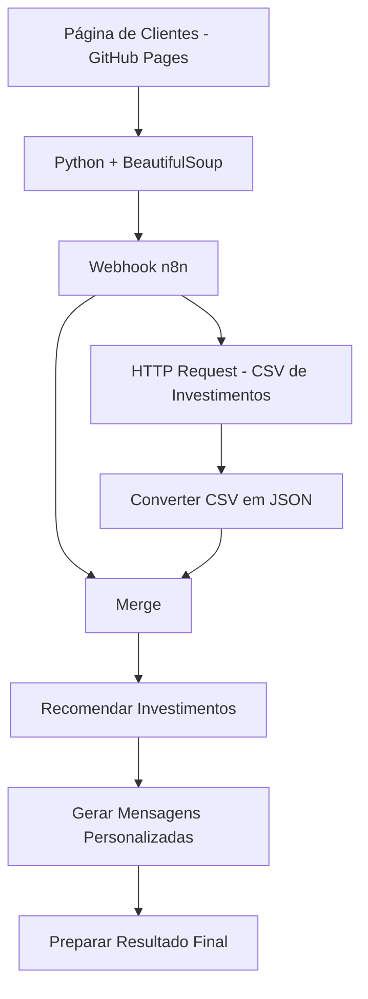

# Criando um Assistente de Investimentos com RPA e IA Generativa

Projeto desenvolvido como parte de um desafio prático da **DIO (Digital Innovation One)**, utilizando Python, Docker e n8n para construir um fluxo de automação voltado à análise de perfis de investidores e à geração de mensagens personalizadas.

Este repositório é um fork do projeto original disponibilizado pela DIO, com a implementação de um script de extração de clientes e de um workflow de automação no n8n.

## 1. Descrição

O objetivo do projeto é demonstrar como técnicas de **RPA (Robotic Process Automation)** podem ser combinadas com ferramentas de automação para coletar informações, processar dados e preparar recomendações de investimentos.

A solução utiliza uma página web simulada, disponibilizada pela DIO, contendo clientes fictícios com diferentes perfis de investidores.

O processo foi dividido em duas partes principais:

- **Python:** responsável por acessar a página web, extrair os dados dos clientes e enviá-los ao n8n.
- **n8n:** responsável por receber os clientes, consultar uma base de investimentos, organizar os dados, relacionar os perfis e gerar mensagens personalizadas.

A arquitetura também permite a evolução futura para integração com modelos de IA generativa.

## 2. Objetivo do Projeto

Desenvolver um pipeline de automação capaz de:

1. Coletar dados de clientes de uma página HTML utilizando Python e BeautifulSoup.
2. Enviar os dados extraídos para um Webhook HTTP no n8n.
3. Consultar uma base CSV contendo opções de investimentos.
4. Relacionar os investimentos aos perfis Conservador, Moderado e Arrojado.
5. Preparar mensagens personalizadas para cada cliente.
6. Organizar os resultados para utilização em outras integrações.

O projeto tem finalidade educacional e utiliza dados fictícios.

## 3. Tecnologias Utilizadas

| Tecnologia | Finalidade |
|---|---|
| Python 3.12 | Executar o processo de extração dos clientes |
| Requests | Realizar requisições HTTP |
| BeautifulSoup | Extrair informações da tabela HTML |
| Docker | Executar Python e n8n em containers |
| n8n | Orquestrar o workflow de automação |
| JavaScript | Processar os investimentos e gerar mensagens |
| GitHub | Versionamento e documentação |
| GitHub Pages | Disponibilizar a página de clientes e o CSV |

O desenvolvimento foi realizado em ambiente Windows, utilizando PowerShell e Visual Studio Code como ferramentas auxiliares.

## 4. Arquitetura da Solução

O processo começa na página web da DIO. O Python extrai as informações dos clientes e as envia para um Webhook do n8n.

Dentro do workflow, uma requisição HTTP consulta o CSV de investimentos. Os dados são convertidos para JSON e relacionados aos clientes conforme seus respectivos perfis.



O workflow é composto por sete nós, incluindo a junção dos dados recebidos pelas duas entradas do Merge.

## 5. Estrutura do Workflow no n8n

### Nó 1 — Webhook

Responsável por receber os dados enviados pelo script Python.

Configuração:

- Método HTTP: `POST`
- Caminho: `clientes`
- Formato recebido: JSON
- Resposta: imediata

Exemplo de estrutura recebida:

```json
{
  "clientes": [
    {
      "nome": "Ana Silva",
      "email": "ana@email.com",
      "saldo": "R$ 12.500,00",
      "perfil": "Conservador"
    }
  ]
}
```

### Nó 2 — HTTP Request

Responsável por consultar o arquivo CSV disponibilizado pela DIO.

Fonte:

https://digitalinnovationone.github.io/dio-lab-assistente-investimentos-rpa-n8n/data.csv

Método HTTP: `GET`.

### Nó 3 — Converter CSV em JSON

Utiliza JavaScript para preparar a conversão dos registros CSV em objetos JSON.

O código identifica o cabeçalho, separa os campos e organiza os investimentos para processamento posterior.

A implementação considera um CSV simples, sendo necessária validação adicional para formatos mais complexos.

### Nó 4 — Merge

Responsável por reunir os dados provenientes de duas entradas:

- Input 1: clientes recebidos pelo Webhook.
- Input 2: investimentos convertidos do CSV.

Configuração utilizada: `Append`.

O Merge reúne os registros, enquanto o nó seguinte realiza a correspondência entre os perfis.

### Nó 5 — Recomendar Investimentos

Utiliza JavaScript para relacionar cada cliente às opções de investimento compatíveis com seu perfil.

Os perfis considerados são:

| Perfil | Direcionamento educacional |
|---|---|
| Conservador | Maior foco em estabilidade e renda fixa |
| Moderado | Equilíbrio entre segurança e risco |
| Arrojado | Maior tolerância a risco e volatilidade |

A lógica depende da compatibilidade entre os nomes das colunas do CSV e os campos esperados pelo código.

### Nó 6 — Gerar Mensagens Personalizadas

Prepara uma mensagem utilizando:

- Nome do cliente.
- Saldo informado.
- Perfil de investidor.
- Investimentos identificados como compatíveis.

A geração atual utiliza templates em JavaScript, sem chamadas a modelos de linguagem.

### Nó 7 — Preparar Resultado Final

Organiza os resultados em uma estrutura JSON contendo informações do cliente, quantidade de investimentos identificados, mensagem gerada e status do processamento.

Essa estrutura poderá ser utilizada futuramente para envio de e-mails, integração com outras APIs ou armazenamento em banco de dados.

## 6. Extração de Clientes com Python

O script `extrair_clientes.py` foi implementado para acessar a página de clientes da DIO e extrair os dados de sua tabela HTML.

Fonte:

https://digitalinnovationone.github.io/dio-lab-assistente-investimentos-rpa-n8n/

A extração utiliza a biblioteca BeautifulSoup e o seletor:

```python
linhas = soup.select("#clientes tbody tr")
```

Cada registro é organizado com os seguintes campos:

- `nome`
- `email`
- `saldo`
- `perfil`

Após a extração, o script envia os dados ao n8n utilizando uma requisição POST.

```python
resposta_n8n = requests.post(
    N8N_WEBHOOK,
    json={"clientes": clientes},
    timeout=30
)

resposta_n8n.raise_for_status()
```

A URL do Webhook utilizada durante o desenvolvimento foi configurada para comunicação entre containers Docker e o host Windows.

## 7. Execução do Python com Docker

Como o ambiente de desenvolvimento não possui Python instalado diretamente no Windows, foi utilizada uma imagem Docker com Python 3.12.

Com o arquivo `extrair_clientes.py` disponível no diretório atual, a execução básica pode ser realizada com:

```powershell
docker run --rm `
  -v "${PWD}:/app" `
  -w /app `
  python:3.12-slim `
  sh -c "pip install requests beautifulsoup4 && python extrair_clientes.py"
```

Antes da execução, é necessário configurar a URL do Webhook no script e garantir que o n8n esteja acessível.

### Observação sobre certificados SSL

Durante o desenvolvimento, o ambiente apresentou problemas de validação de certificados HTTPS relacionados à infraestrutura de rede.

Para executar o script Python, foi utilizado um certificado de autoridade confiável do ambiente, disponibilizado localmente ao container Docker.

O comando utilizado nesse ambiente foi:

```powershell
docker run --rm `
  -v "${PWD}:/app" `
  -w /app `
  -e PIP_CERT=/app/fortinet-ca.pem `
  -e REQUESTS_CA_BUNDLE=/app/fortinet-ca.pem `
  python:3.12-slim `
  sh -c "pip install --quiet requests beautifulsoup4 && python extrair_clientes.py"
```

**Importante:** esse comando é específico do ambiente de desenvolvimento. O certificado corporativo não está incluído no repositório e não é necessário em ambientes com certificados HTTPS públicos corretamente reconhecidos.

## 8. Resultados Obtidos

Durante os testes, o script Python conseguiu acessar a página da DIO e extrair **10 clientes fictícios**.

Os dados foram apresentados no terminal e enviados ao Webhook do n8n.

Exemplo de retorno observado:

```text
Clientes encontrados: 10

Dados enviados ao n8n com sucesso!
{"message":"Workflow was started"}
```

A comunicação entre Python e n8n foi confirmada por meio da resposta HTTP e das execuções registradas na ferramenta.

### Funcionalidades verificadas

- [x] Repositório criado a partir do fork da DIO.
- [x] Extração dos clientes com Python e BeautifulSoup.
- [x] Execução do Python em container Docker.
- [x] Envio dos clientes por requisição HTTP POST.
- [x] Recebimento dos dados pelo Webhook do n8n.
- [x] Publicação do workflow no n8n.
- [x] Implementação estrutural dos sete nós.
- [x] Exportação do workflow para JSON.
- [x] Publicação do código e do workflow no GitHub.

### Funcionalidades ainda não validadas

- [ ] Leitura completa do CSV pelo HTTP Request no n8n.
- [ ] Correspondência dos investimentos com os perfis utilizando dados reais do CSV.
- [ ] Geração final das mensagens em execução de ponta a ponta.
- [ ] Envio automático de mensagens por e-mail.
- [ ] Integração com um modelo de IA generativa.

## 9. Limitações Encontradas

Durante a configuração do HTTP Request no n8n, foi identificado um problema de validação de certificado SSL na conexão HTTPS com o arquivo CSV.

Mensagem observada:

```text
self-signed certificate in certificate chain
```

O ambiente utilizava mecanismos de inspeção HTTPS e certificados adicionais de segurança.

Foi realizada uma configuração para disponibilizar a autoridade certificadora ao Node.js no container do n8n. Entretanto, não foi confirmada uma execução completa do HTTP Request com o CSV.

Por esse motivo, o workflow foi desenvolvido e exportado, mas **o processamento completo, desde a consulta dos investimentos até a geração final das mensagens, permanece pendente de validação**.

A decisão foi preservar a estrutura do projeto e documentar a limitação técnica, mantendo o trabalho disponível para correções e evoluções futuras.

## 10. IA Generativa — Evolução Futura

O desafio original também propõe a utilização de IA generativa para produzir mensagens mais contextualizadas.

A implementação atual utiliza JavaScript e templates estáticos ou semiestáticos.

Como evolução, o workflow poderá incorporar um modelo de linguagem, como Gemini ou GPT, para:

- Interpretar o contexto do cliente.
- Elaborar mensagens individualizadas.
- Adaptar a linguagem ao perfil informado.
- Produzir explicações educacionais sobre alternativas de investimento.

A integração com LLM não foi implementada nesta versão.

## 11. Estrutura do Repositório

Os arquivos principais estão organizados da seguinte forma:

```text
dio-lab-assistente-investimentos-rpa-n8n/
├── README.md
├── extrair_clientes.py
├── workflow.json
├── rpa/
│   └── extrair_clientes.ipynb
└── docs/
    ├── index.html
    └── data.csv
```

O notebook original permanece como referência didática, enquanto o arquivo `extrair_clientes.py` representa a implementação utilizada nos testes com Docker.

O arquivo `workflow.json` contém os nós e as conexões exportados do n8n.

## 12. Como Importar o Workflow

Para importar a automação em outra instância do n8n:

1. Abra o n8n.
2. Crie um novo workflow.
3. Utilize a opção de importar workflow de arquivo.
4. Selecione `workflow.json`.
5. Confira a configuração do nó Webhook.
6. Ajuste os endereços e as credenciais conforme o ambiente.
7. Verifique o acesso ao CSV e execute os testes necessários.

A importação recria a estrutura do workflow, mas não garante seu funcionamento sem os ajustes de ambiente e as validações pendentes.

## 13. Próximas Melhorias

O projeto poderá evoluir com:

- Correção definitiva do acesso HTTPS ao CSV.
- Validação dos nomes das colunas e dos formatos dos investimentos.
- Tratamento de erros e registros inválidos.
- Testes automatizados do processamento.
- Integração com IA generativa.
- Envio de mensagens por e-mail.
- Persistência de resultados em banco de dados.
- Configuração mais segura do Webhook, com autenticação adequada.

## 14. Referências

- [Projeto original da DIO](https://github.com/digitalinnovationone/dio-lab-assistente-investimentos-rpa-n8n)
- [Documentação oficial do n8n](https://docs.n8n.io/)
- [Documentação do Python](https://docs.python.org/3/)
- [BeautifulSoup — Web Scraping](https://realpython.com/beautiful-soup-web-scraper-python/)
- [Documentação do Docker](https://docs.docker.com/)
- [GitHub Pages](https://pages.github.com/)

---

## Considerações Finais

O desenvolvimento deste projeto permitiu praticar conceitos de RPA, web scraping, requisições HTTP, Docker e automação de workflows com n8n.

A principal conquista prática foi integrar a extração automatizada de dados em Python ao Webhook do n8n, demonstrando a comunicação entre diferentes tecnologias.

Embora algumas funcionalidades permaneçam pendentes de validação, o projeto apresenta uma estrutura de automação que poderá ser aprimorada e expandida.

**Projeto desenvolvido para fins educacionais como parte de um desafio da DIO — Digital Innovation One.**

*As informações de investimento são fictícias e educacionais, não constituindo aconselhamento financeiro individualizado.*
